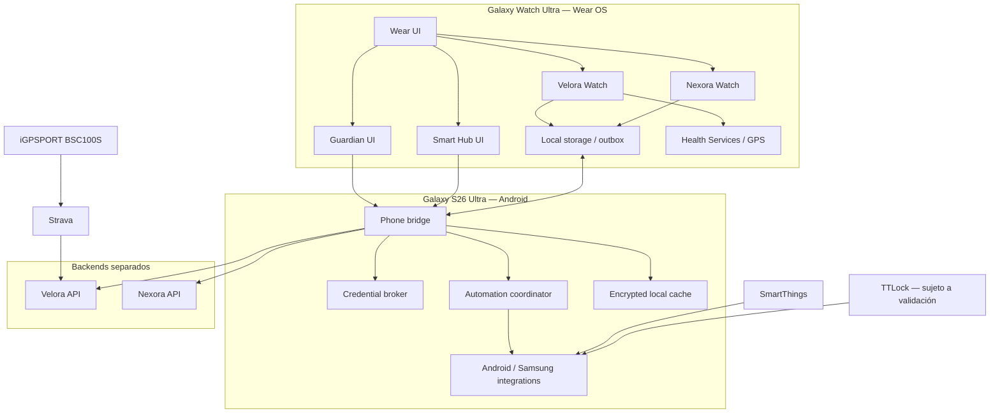

# 00 — Arquitectura general

## 1. Principios

- **Separación de dominios:** Velora y Nexora conservan APIs, persistencia, autenticación y reglas de negocio independientes.
- **Watch como cliente:** el reloj no se convierte en backend ni fuente maestra de información financiera.
- **Phone bridge:** el S26 Ultra coordina tareas que requieren capacidades del teléfono, integraciones Android o conectividad adicional.
- **Offline-first donde sea necesario:** las actividades deportivas deben sobrevivir a desconexiones y fallos de red.
- **Privacidad por módulo:** permisos de salud, ubicación, finanzas y hogar se solicitan por separado y solo cuando se necesitan.
- **No duplicar efectos:** operaciones y actividades deben tener claves de idempotencia y estados explícitos.
- **Degradación segura:** si una integración no está disponible, informar y conservar datos locales; nunca simular éxito.

## 2. Repositorio nuevo

Crear `watch-companion`, aplicación Android modular con destino Wear OS. Evaluar si conviene incluir el companion de teléfono en el mismo repositorio Gradle o mantener un módulo móvil separado. No modificar los seis repositorios existentes sin una tarea de integración concreta.

Estructura inicial sugerida (adaptar al estado real de Android Gradle Plugin y Kotlin):

```text
watch-companion/
  app-watch/
  app-phone/
  core/
    common/
    design-system/
    network/
    security/
    datastore/
    phone-communication/
    permissions/
    notifications/
  feature/
    velora/
    nexora/
    guardian/
    smart-home/
  integration/
    velora-contract/
    nexora-contract/
  docs/
  gradle/
```

Los nombres son una propuesta; no son una exigencia para crear módulos vacíos sin uso.

## 3. Vista lógica



## 4. Responsabilidades por sistema

| Sistema | Responsabilidad |
|---|---|
| `velora-api` | Actividades, ingestión de fuentes, normalización, analítica, rutas y deduplicación |
| `velora-android` | Experiencia Android existente de Velora; no duplicar su lógica |
| `velora-web` | Visualización y análisis de actividades |
| `nexora-api` | Cuentas, tarjetas, transacciones, presupuestos, pagos y reglas financieras |
| `nexora-android` | Experiencia Android existente de Nexora |
| `nexora-web` | Experiencia web existente de Nexora |
| `watch-companion` | UI Wear OS, sensores, acciones rápidas y comunicación con el teléfono |
| S26 Ultra | Puente de integraciones y automatizaciones autorizadas |

## 5. Comunicación Watch ↔ Phone

Usar Wear OS Data Layer API para sincronizar mensajes, estados y pequeñas cargas entre dispositivos emparejados. No tratar Data Layer como sustituto de HTTPS hacia los backends.

Definir mensajes versionados:

- `WorkoutCommand`
- `WorkoutStatus`
- `WatchTelemetryBatch`
- `FinanceSnapshotRequest`
- `FinanceSnapshotResponse`
- `QuickTransactionDraft`
- `GuardianEvent`
- `SmartHomeCommand`
- `IntegrationStatus`

Todo mensaje debe incluir `messageId`, `schemaVersion`, `createdAt`, `deviceId` y `correlationId` cuando aplique.

No enviar credenciales ni tokens de acceso en mensajes de Data Layer. El teléfono obtiene credenciales de forma segura y realiza las llamadas remotas cuando sea la opción más segura.

## 6. Backend y autenticación

- Velora y Nexora deben conservar emisores, audiencias y scopes independientes.
- No compartir refresh tokens entre módulos.
- El reloj **no tiene tokens de backend** en el MVP (ADR-013): solo `app-phone` se autentica contra Velora y Nexora, y el reloj se comunica únicamente por Data Layer. Una sesión propia del reloj (OAuth Device Authorization o pairing de un solo uso) queda como evolución y requiere soporte nuevo en los backends.
- No guardar secretos de cliente OAuth en el APK.
- Si se añade BFF/bridge, que sea mínimo y no se convierta en una API de negocio compartida.
- El teléfono debe aplicar WorkManager para trabajos diferidos y reintentos; no depender de ejecución perpetua en background.

## 7. Contratos

Consumir OpenAPI publicado por cada API y generar clientes cuando el proceso actual lo permita. No copiar DTOs manualmente si existe generación estable. Versionar cambios incompatibles.

Antes de implementar, revisar las especificaciones OpenAPI reales y la autenticación ya existente en ambos backends.

## 8. Observabilidad

Registrar eventos técnicos sin datos financieros ni coordenadas exactas innecesarias:

- módulo y versión
- estado de conectividad
- operación y correlation ID
- resultado y código de error
- duración
- estado de sincronización

Para actividades, conservar auditoría de fuentes y transformaciones. No registrar tokens, secretos, datos bancarios completos ni muestras biométricas en logs.
