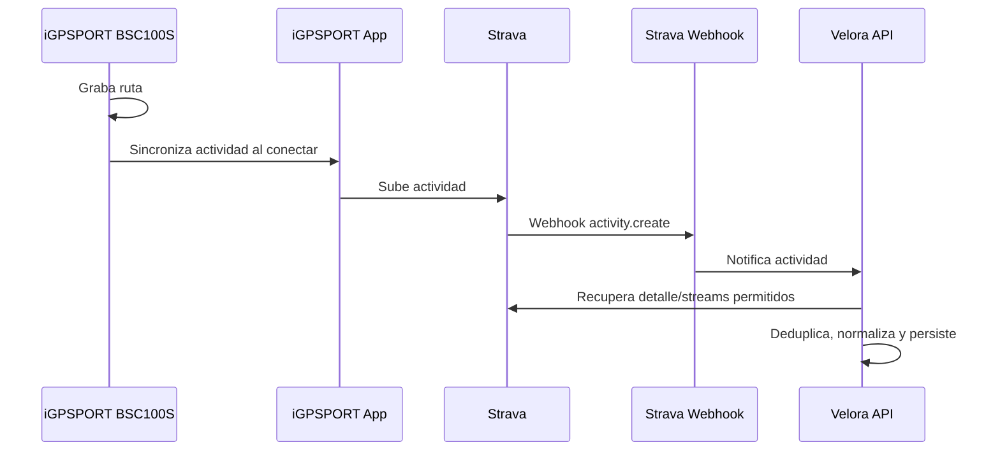

# 02 — ADR: iGPSPORT BSC100S, Galaxy Watch, Strava y Velora

## Estado

**Aceptada para MVP:** BSC100S como fuente principal; Watch como companion.  
**Pendiente de implementación:** grabación dual de respaldo.  
**Futuro:** reconciliación/fusión de tracks.

## 1. Flujo actual que debe preservarse

La notificación webhook contiene identificadores y tipo de evento; no es el archivo FIT ni todos los streams. El backend debe recuperar la información necesaria mediante la API de Strava y respetar los scopes autorizados.

## 2. Riesgo principal: duplicados

Si el BSC100S sube una actividad a Strava y el Watch también sube otra actividad del mismo recorrido:

- Strava mostrará dos actividades.
- Velora recibirá dos eventos de creación.
- Ambas pueden parecer la misma salida, pero tener distinto ID.
- La deduplicación por `stravaActivityId` no basta para detectar que son dos dispositivos grabando el mismo recorrido.

Por tanto, la política predeterminada es **no subir la grabación Watch a Strava cuando BSC100S sea la fuente principal**.

## 3. Estrategias comparadas

| Estrategia | Ventaja | Riesgo | Decisión |
|---|---|---|---|
| BSC100S principal + Watch companion | Flujo simple y una sola actividad | Watch no es backup completo de GPS | MVP |
| Grabación dual, Watch sin publicar | Respaldo recuperable | Más almacenamiento y sincronización | V1 |
| Fusionar ambos y publicar un solo track | Puede mejorar continuidad/calidad | Complejidad, discrepancias y duplicados | Futuro |
| Watch como único grabador | Independencia del BSC100S | Menor integración con sensores/ciclocomputador | Fallback |

## 4. Qué significa fusionar

No concatenar archivos ni promediar coordenadas de forma ingenua.

La reconciliación debe:

1. Conservar el archivo original de cada dispositivo.
2. Normalizar timestamps a UTC y preservar zona horaria original.
3. Estimar desfase entre dispositivos usando puntos coincidentes.
4. Comparar muestras dentro de ventanas temporales.
5. Rechazar puntos con precisión insuficiente o saltos imposibles.
6. Preferir una fuente por tramo según calidad y continuidad.
7. Evitar interpolar sobre huecos largos sin marcarlo.
8. Mantener procedencia por muestra o segmento.
9. Calcular métricas derivadas sobre el track canónico.
10. Generar un informe de calidad y discrepancias.

La altitud barométrica del BSC100S y la altitud GPS del reloj no deben mezclarse sin calibración. Se debe conservar el tipo de sensor y aplicar corrección/filtrado explícitos.

## 5. Modelo de datos sugerido

Nombres conceptuales; adaptar al modelo existente de Velora.

### `activity_source_recording`

- `id`
- `activity_id` nullable hasta asociar
- `source_type`: `IGPSPORT_STRAVA`, `WATCH_GPS`, `WATCH_HEALTH`, `MANUAL_IMPORT`
- `source_device_id` (pseudónimo, no identificador sensible innecesario)
- `external_activity_id` nullable
- `recording_started_at`
- `recording_ended_at`
- `received_at`
- `original_file_uri` o referencia a almacenamiento de objetos
- `file_sha256`
- `status`
- `metadata_json`

### `activity_track_sample`

- `id`
- `recording_id`
- `sample_time_utc`
- `latitude`
- `longitude`
- `altitude_m`
- `speed_mps`
- `heart_rate_bpm`
- `cadence_rpm`
- `power_w`
- `horizontal_accuracy_m`
- `source_sequence`
- `quality_flags`

No guardar todos los campos como si estuvieran siempre disponibles. Los valores ausentes deben ser null y no cero.

### `activity_reconciliation`

- `id`
- `activity_id`
- `algorithm_version`
- `status`: `PENDING`, `REVIEW_REQUIRED`, `ACCEPTED`, `REJECTED`
- `time_offset_ms`
- `distance_delta_m`
- `duration_delta_s`
- `track_distance_delta_m`
- `quality_summary`
- `created_at`
- `accepted_at`

### `activity_canonical_track`

- `activity_id`
- `reconciliation_id` nullable
- `track_version`
- `geometry` (PostGIS si el modelo actual lo soporta)
- `derived_metrics`
- `created_at`

## 6. Idempotencia y deduplicación

- Webhook idempotency key: combinación de `subscription_id`, `object_type`, `object_id`, `aspect_type`, `event_time` y/o identificador de evento disponible.
- Fuente Strava: `athlete_id + strava_activity_id`.
- Fuente Watch: UUID de sesión generado localmente y estable.
- Archivo: SHA-256 para detectar reenvíos idénticos, no como única clave semántica.
- Nunca fusionar solo porque dos actividades tienen fecha y distancia parecidas.
- La detección de posible duplicado debe producir una sugerencia, no borrar automáticamente.

Los webhooks pueden reintentarse. El endpoint debe responder rápidamente y procesar en background; guardar el evento antes de encolarlo.

## 7. Publicación en Strava

Regla inicial: solo el flujo iGPSPORT actual publica en Strava.

Si en el futuro se decide publicar una ruta reconciliada:
- debe existir una política explícita de publicación;
- evitar que el original y la ruta reconciliada queden visibles como dos actividades;
- validar qué permite Strava para archivos y actividades existentes;
- no asumir que una actividad creada por iGPSPORT se puede reemplazar por otra mediante una simple actualización;
- solicitar confirmación antes de publicar.

## 8. Pruebas obligatorias

- BSC100S sube una sola actividad; webhook duplicado.
- BSC100S sube una sola actividad; Velora reintenta importación.
- Watch pierde conectividad durante una salida.
- Watch se queda sin batería y recupera sesión parcial.
- BSC100S y Watch registran con offset de reloj.
- Track de Watch tiene huecos GPS.
- Track del BSC100S contiene altitud barométrica.
- Distancias difieren de forma significativa.
- El usuario cancela una reconciliación.
- Un evento Strava `delete` o `update` no elimina datos locales de respaldo sin política de retención.

## 9. Preguntas técnicas que deben resolverse en una prueba de concepto

- ¿La app iGPSPORT permite exportar el FIT original del BSC100S y en qué condiciones?
- ¿Velora ya descarga streams de Strava o solo resumen y polyline?
- ¿Qué scopes de Strava tiene concedidos la aplicación actual?
- ¿Qué intervalo de muestreo y precisión GPS entrega el Watch en rutas reales?
- ¿La HR del Watch y la HR del BSC100S/banda difieren de forma relevante?
- ¿Qué dispositivo se considera autoridad para distancia, elevación y HR en el modo A?

No bloquear el MVP por las preguntas de fusión: el modo A puede funcionar sin ellas.
