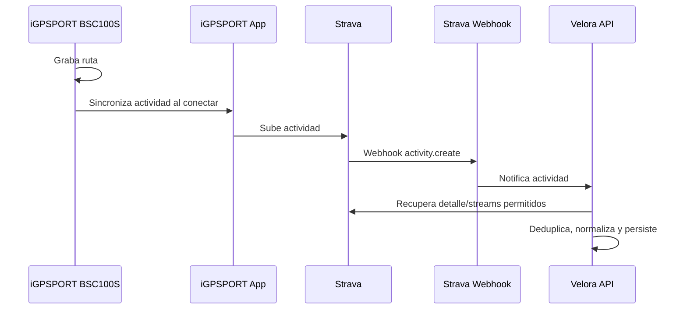

# 02 — Grabación de actividades: iGPSPORT BSC100S, Galaxy Watch, Strava y Velora

Desarrolla WC-ADR-002 a WC-ADR-005 de `08`; las decisiones viven allí y este documento detalla flujos, datos y reglas.

## Estado

**Aceptada para MVP:** BSC100S como fuente principal; Watch como companion.  
**Implementada:** grabación dual de respaldo. El reloj graba su track (WC-53), lo entrega al teléfono y el teléfono lo sube a Velora como **grabación secundaria** (WC-54, ADR-032 de Velora): una sola actividad lógica, aunque las dos lleguen en cualquier orden.  
**Futuro:** reconciliación/fusión de tracks.

## 1. Flujo actual que debe preservarse

La notificación webhook contiene identificadores y tipo de evento; no es el archivo FIT ni todos los streams. El backend debe recuperar la información necesaria mediante la API de Strava y respetar los scopes autorizados.

## 2. Riesgo principal: duplicados

Si el BSC100S sube una actividad a Strava y el Watch también sube otra actividad del mismo recorrido:

- Strava mostrará dos actividades.
- Velora recibirá dos eventos de creación.
- Ambas pueden parecer la misma salida, pero tener distinto ID.
- La deduplicación por `stravaActivityId` no basta para detectar que son dos dispositivos grabando el mismo recorrido.

Por tanto, la política predeterminada es **no subir la grabación Watch a Strava cuando BSC100S sea la fuente principal**.

## 3. Estrategias comparadas

| Estrategia | Ventaja | Riesgo | Decisión |
|---|---|---|---|
| BSC100S principal + Watch companion | Flujo simple y una sola actividad | Watch no es backup completo de GPS | MVP |
| Grabación dual, Watch sin publicar | Respaldo recuperable | Más almacenamiento y sincronización | V1 |
| Fusionar ambos y publicar un solo track | Puede mejorar continuidad/calidad | Complejidad, discrepancias y duplicados | Futuro |
| Watch como único grabador | Independencia del BSC100S | Menor integración con sensores/ciclocomputador | Fallback |

## 4. Qué significa fusionar

No concatenar archivos ni promediar coordenadas de forma ingenua.

La reconciliación debe:

1. Conservar el archivo original de cada dispositivo.
2. Normalizar timestamps a UTC y preservar zona horaria original.
3. Estimar desfase entre dispositivos usando puntos coincidentes.
4. Comparar muestras dentro de ventanas temporales.
5. Rechazar puntos con precisión insuficiente o saltos imposibles.
6. Preferir una fuente por tramo según calidad y continuidad.
7. Evitar interpolar sobre huecos largos sin marcarlo.
8. Mantener procedencia por muestra o segmento.
9. Calcular métricas derivadas sobre el track canónico.
10. Generar un informe de calidad y discrepancias.

La altitud barométrica del BSC100S y la altitud GPS del reloj no deben mezclarse sin calibración. Se debe conservar el tipo de sensor y aplicar corrección/filtrado explícitos.

## 5. Modelo de datos sugerido

Nombres conceptuales; adaptar al modelo existente de Velora.

### `activity_source_recording`

- `id`
- `activity_id` nullable hasta asociar
- `source_type`: `IGPSPORT_STRAVA`, `WATCH_GPS`, `WATCH_HEALTH`, `MANUAL_IMPORT`
- `source_device_id` (pseudónimo, no identificador sensible innecesario)
- `external_activity_id` nullable
- `recording_started_at`
- `recording_ended_at`
- `received_at`
- `original_file_uri` o referencia a almacenamiento de objetos
- `file_sha256`
- `status`
- `metadata_json`

### `activity_track_sample`

- `id`
- `recording_id`
- `sample_time_utc`
- `latitude`
- `longitude`
- `altitude_m`
- `speed_mps`
- `heart_rate_bpm`
- `cadence_rpm`
- `power_w`
- `horizontal_accuracy_m`
- `source_sequence`
- `quality_flags`

No guardar todos los campos como si estuvieran siempre disponibles. Los valores ausentes deben ser null y no cero.

### `activity_reconciliation`

- `id`
- `activity_id`
- `algorithm_version`
- `status`: `PENDING`, `REVIEW_REQUIRED`, `ACCEPTED`, `REJECTED`
- `time_offset_ms`
- `distance_delta_m`
- `duration_delta_s`
- `track_distance_delta_m`
- `quality_summary`
- `created_at`
- `accepted_at`

### `activity_canonical_track`

- `activity_id`
- `reconciliation_id` nullable
- `track_version`
- `geometry` (PostGIS si el modelo actual lo soporta)
- `derived_metrics`
- `created_at`

## 6. Idempotencia y deduplicación

**Strava → Velora ya está resuelto en Velora** (ADR-030 de Velora) y el companion no lo reespecifica (A-04):
- cada evento del webhook se guarda tal cual en `strava_webhook_events` antes de procesarse; el endpoint responde de inmediato;
- la deduplicación semántica ocurre en `strava_sync_items (user_id, strava_activity_id)`: un reintento o un evento repetido no crea otra actividad;
- `update` y `delete` actualizan o marcan `DELETED` ese mismo ítem.

Lo que sí define el companion, para cuando exista la grabación del Watch (Fase 5):
- Fuente Watch: UUID de sesión generado localmente y estable.
- Archivo: SHA-256 para detectar reenvíos idénticos, no como única clave semántica (Velora ya guarda el SHA-256 en `activity_files`).
- Nunca fusionar solo porque dos actividades tienen fecha y distancia parecidas.
- La detección de posible duplicado produce una sugerencia, no borra automáticamente (igual que `DuplicateHeuristic` y `GET /activities/{id}/possible-duplicates` de Velora).

## 7. Publicación en Strava

Regla inicial: solo el flujo iGPSPORT actual publica en Strava.

Si en el futuro se decide publicar una ruta reconciliada:
- debe existir una política explícita de publicación;
- evitar que el original y la ruta reconciliada queden visibles como dos actividades;
- validar qué permite Strava para archivos y actividades existentes;
- no asumir que una actividad creada por iGPSPORT se puede reemplazar por otra mediante una simple actualización;
- solicitar confirmación antes de publicar.

## 8. Pruebas obligatorias

- BSC100S sube una sola actividad; webhook duplicado.
- BSC100S sube una sola actividad; Velora reintenta importación.
- Watch pierde conectividad durante una salida.
- Watch se queda sin batería y recupera sesión parcial.
- BSC100S y Watch registran con offset de reloj.
- Track de Watch tiene huecos GPS.
- Track del BSC100S contiene altitud barométrica.
- Distancias difieren de forma significativa.
- El usuario cancela una reconciliación.
- Un evento Strava `delete` o `update` **no** elimina datos de **origen Watch** sin política de retención, y **sí** elimina lo que provenga de Strava en los plazos de ADR-030 de Velora (ver §8.1).

### 8.1 Borrado: qué protege la regla y qué no (A-02)

| Dato | Origen | Ante un `delete` de Strava |
|---|---|---|
| Actividad importada de Strava, sus streams y metadatos | Strava Data | Se borra según ADR-030 de Velora (compromiso de 48 h, `strava_sync_items` → `DELETED`). El companion no conserva copias. |
| Última actividad que muestra el reloj (`ActivityStatus`, WC-33) | Resumen derivado que el teléfono consulta a Velora | No se guarda en disco; la siguiente consulta ya no la encuentra. |
| Grabación del Watch (modo B, Fase 5) | Watch, no es Strava Data | Se conserva según su propia política de retención; el `delete` de Strava no la toca. |
| FIT original del BSC100S importado directo (respaldo, WC-13) | Dispositivo, no es Strava Data | Igual que la grabación del Watch. |

En el modo A el companion no almacena datos de Strava: el teléfono consulta a Velora y el reloj solo guarda zonas de FC y su propia sesión en curso.

## 9. Preguntas técnicas de la prueba de concepto

Estado al 2026-11-23 (A-04, WC-7):

| Pregunta | Respuesta | Dónde se sigue |
|---|---|---|
| ¿La app iGPSPORT permite exportar el FIT original del BSC100S y en qué condiciones? | **Sí, a mano** desde la app, y Velora lo importa sin cambios (§10). Sigue siendo respaldo: el camino principal es Strava (WC-ADR-005). | Resuelta (WC-13) |
| ¿Velora ya descarga streams de Strava o solo resumen y polyline? | **Sí descarga streams:** `HttpStravaApi.streams()` pide `/activities/{id}/streams?key_by_type=true`; sin stream de tiempo, el ítem queda `NO_DATA`. | Resuelta |
| ¿Qué scopes de Strava tiene concedidos la aplicación actual? | **`read,activity:read_all`** (verificado en producción el 23/11/2026; conectado desde el 15/11/2026). Es el mínimo que pide el conector de Velora, sin `activity:write`: Velora no puede modificar nada en Strava. El companion solo usa `GET /integrations/strava` de Velora, sin scopes propios. Documentado en `velora-api/docs/operacion.md`. | Resuelta (WC-26) |
| ¿Qué intervalo de muestreo y precisión GPS entrega el Watch en rutas reales? | **Abierta**, solo aplica al modo B; el MVP no usa GPS del reloj. | WC-53, WC-57 |
| ¿La HR del Watch y la HR del BSC100S/banda difieren de forma relevante? | **En medición:** la plantilla de las salidas de la Fase 1 compara la FC del reloj con la del BSC100S/banda. | WC-35 (`10` §5) |
| ¿Qué dispositivo es autoridad para distancia, elevación y HR en el modo A? | **Resuelta por WC-ADR-010:** track, distancia y elevación del BSC100S; HR de la fuente configurada y etiquetada; la actividad lógica es la de Velora. La FC en vivo del reloj solo se muestra y alerta, no se guarda ni se sube. | Resuelta |

No bloquear el MVP por las preguntas de fusión: el modo A funciona sin ellas.

## 10. Respaldo: el FIT directo del BSC100S (WC-13)

Si Strava falla o se desconecta, la actividad del BSC100S puede llegar a Velora sin Strava.

**Procedimiento verificado (27/11/2026):**
1. App iGPSPORT → la salida → **exportar .fit** → guardar en el teléfono (queda en `Descargas/Archivos/ride-0-<fecha>-<hora>.fit`).
2. Pasar el archivo a la computadora y subirlo a Velora: `POST /api/v1/activities/imports` (multipart `file`) → `202` con `jobId` → `GET /api/v1/imports/<jobId>`.

**Evidencia (Velora local, una salida corta):**

| Qué | Resultado |
|---|---|
| Archivo | FIT válido, protocolo 2.0, perfil 20.74, 6,5 KB; `file_id` con fabricante **115 (iGPSPORT)**: es el archivo del aparato, no uno regenerado por Strava |
| Contenido | 206 `record`, 2 vueltas, 8 eventos, `device_info`, `session` y `activity` |
| Muestreo | ~5 s entre puntos (206 puntos en 17 min en movimiento): grabación inteligente del BSC100S |
| Importación | `COMPLETED` en 1,2 s, sin avisos ni posibles duplicados |
| Lo que leyó Velora | 5,85 km, 17:20 en movimiento de 41:08 totales, +25/−24 m, vel. máx. 35 km/h, 2 vueltas; streams de tiempo, distancia, posición, altitud, velocidad y temperatura; todas las métricas `DEVICE_REPORTED` |

**Lo que no funcionó o no se probó:**
- **USB:** con el cable usado, el BSC100S no apareció en la Mac ni como disco ni como dispositivo USB. Puede ser un cable solo de carga; no se descarta que monte como disco con otro cable (otros iGPSPORT exponen `iGPSPORT/Activities/*.fit`).
- **Strava «Exportar original»:** sigue siendo válido como tercera vía, pero Strava puede entregar el archivo ya procesado; el de la app es más directo.

**¿Se puede automatizar?** Hoy no, sin trabajo extra:
- iGPSPORT no publica una API para terceros; la exportación es manual desde la app.
- La API de Strava no entrega el archivo original (solo resumen y streams, que Velora ya usa).
- **Opción a futuro, sin tarjeta:** que la app del teléfono del companion aparezca en **Compartir** para archivos `.fit` y los suba a Velora con la sesión ya iniciada. Reduce el respaldo a «exportar → compartir → companion». Vale la pena solo si el camino de Strava falla seguido.

**Para WC-57:** el muestreo de ~5 s del BSC100S importa para las tolerancias: un hueco de 10 s en el BSC100S son solo dos puntos perdidos, así que el umbral de hueco debe medirse contra su intervalo real y no contra 1 s.
