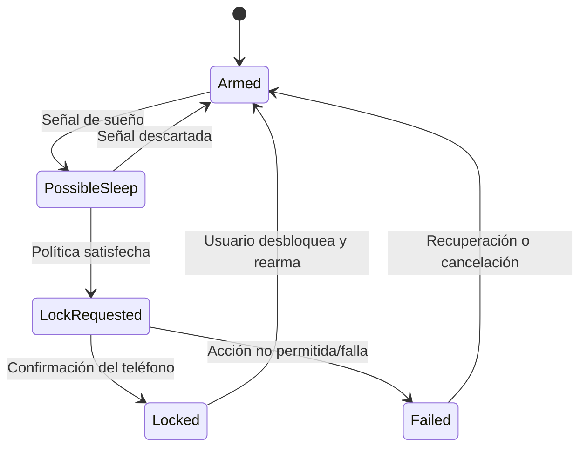

# 04 — Watch Guardian: seguridad del Galaxy S26 Ultra

## 1. Objetivo

Crear un módulo que use eventos del Galaxy Watch Ultra para activar automatizaciones autorizadas en el S26 Ultra.

No prometer bloqueo automático basado únicamente en la detección de sueño: los sensores pueden producir falsos positivos y Android limita acciones privilegiadas.

## 2. Casos de uso

- Bloqueo manual inmediato desde el reloj.
- Alerta cuando el reloj se desconecta del teléfono.
- Alerta cuando el teléfono queda lejos, si la señal permite una estimación razonable.
- Señal de posible sueño para iniciar una política configurable.
- Confirmación de que el teléfono quedó bloqueado.
- Historial local de eventos de seguridad.

## 3. Política de bloqueo

Separar explícitamente:

### Bloqueo normal
Usar las capacidades Android/Samsung disponibles para bloquear o apagar la pantalla, sujetas a restricciones de versión y permisos.

### Bloqueo reforzado
Investigar `DevicePolicyManager.lockNow()` y sus requisitos reales. No asumir que una app ordinaria puede usarlo. Requiere administración de dispositivo/política autorizada; evaluar implicaciones de enrolamiento, desinstalación y compatibilidad.

No implementar accesibilidad como atajo para eludir las restricciones del sistema. No usar root ni APIs ocultas.

## 4. Detección de sueño

- Tratar la detección como una señal probabilística.
- Configurar ventana mínima de inactividad y confianza.
- Exigir condiciones adicionales antes de bloquear automáticamente.
- Permitir exclusiones por horario, carga, actividad deportiva o modo manual.
- Permitir desactivar la automatización rápidamente.
- Evitar bloquear durante conducción, ciclismo o situaciones de emergencia.
- Registrar el motivo y nivel de confianza sin almacenar datos de salud innecesarios.

La detección de sueño no es una función de seguridad certificada ni debe utilizarse como prueba concluyente.

## 5. Máquina de estados

## 6. Comunicación

- Watch envía un evento firmado lógicamente mediante pairing autenticado; no confiar en un simple mensaje Bluetooth sin validar sesión.
- Phone valida antigüedad, nonce y estado.
- Comandos sensibles tienen expiración corta.
- El teléfono informa resultado real: `LOCKED`, `REJECTED`, `UNAVAILABLE`, `EXPIRED`.
- Evitar replays con `commandId` y nonce.

## 7. Criterios de aceptación

- Bloqueo manual informa el resultado real.
- No afirma que el teléfono se bloqueó antes de confirmarlo.
- La detección de sueño no dispara acciones durante una actividad deportiva activa.
- La desconexión Bluetooth no se interpreta como prueba de robo.
- El usuario puede desactivar y revocar el módulo.
- No requiere root ni APIs ocultas.
