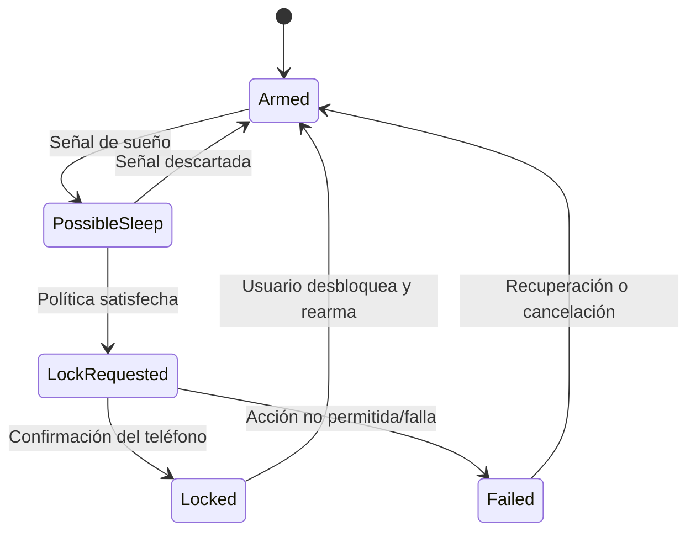

# 04 — Watch Guardian: seguridad del Galaxy S26 Ultra

## 1. Objetivo

Crear un módulo que use eventos del Galaxy Watch Ultra para activar automatizaciones autorizadas en el S26 Ultra.

No prometer bloqueo automático basado únicamente en la detección de sueño: los sensores pueden producir falsos positivos y Android limita acciones privilegiadas.

## 2. Casos de uso

- Bloqueo manual inmediato desde el reloj.
- Alerta cuando el reloj se desconecta del teléfono.
- Alerta cuando el teléfono queda lejos, si la señal permite una estimación razonable.
- Señal de posible sueño para iniciar una política configurable.
- Confirmación de que el teléfono quedó bloqueado.
- Historial local de eventos de seguridad.

**Implementado (WC-45): aviso de desconexión.**
- **Cómo lo sabe:** el reloj recibe de la Data Layer los cambios de alcance de la app del teléfono (`CAPABILITY_CHANGED` de `wc_phone_app`, en `LinkListenerService`) aunque la app esté cerrada. «Cerca» es alcanzable con `Node.isNearby`; alcanzable solo por la nube (LTE o Wi-Fi lejos del teléfono) cuenta como lejos. No usa ubicación, ni sondeo, ni intensidad de señal (R-08).
- **Cuándo avisa:** tras un plazo seguido sin el teléfono, que se elige en Resumen → Guardian: apagado (por omisión), 2, 5, 15 o 30 min. Una revisión de WorkManager confirma al cumplirse el plazo; si la Data Layer no responde, reintenta en vez de avisar.
- **El aviso:** una vibración propia (uso de alarma) y, si hay permiso de notificaciones, una notificación «Teléfono fuera de alcance · Sin conexión con el teléfono desde las HH:mm». Una vez por desconexión; se retira sola cuando el teléfono vuelve. No habla de robo ni de pérdida.
- **Estado:** el plazo y desde cuándo falta el teléfono se guardan en `SharedPreferences` (no son datos personales) para sobrevivir a que el sistema cierre el proceso.
- **Fuera del alcance:** proximidad por intensidad de señal (R-08) y cualquier acción automática en el teléfono.

## 3. Política de bloqueo

**Conclusión (spike WC-43, 26 nov 2026):** hay **un solo mecanismo de bloqueo**: `DevicePolicyManager.lockNow()` con la app registrada como **administrador de dispositivo** y solo la política `force-lock`. Funciona en el S26 Ultra; el «bloqueo normal» y el «reforzado» colapsan en él (R-06), así que esta sección ya no los separa.

### Resultado en el dispositivo

Probado en SM-S948B, Android 17 (SDK 37), One UI 9.0, compilación `S948BXXS4BZIG`, con la app instalada fuera de Play (debug, sin ser *device owner* ni *profile owner*).

| Prueba | Resultado |
|---|---|
| Activar el administrador | One UI lo permite: el diálogo estándar de Android con la explicación de la app, sin advertencias extra. |
| `lockNow()` con la app en primer plano | Bloquea: sin excepción, `isKeyguardLocked`, `isDeviceSecure` y pantalla apagada. |
| `lockNow()` con la app en segundo plano (Chrome al frente) | Bloquea igual. |
| `lockNow()` con el proceso cerrado | El sistema arranca la app para el mensaje y bloquea igual. Es el caso real: la orden llega del reloj. |
| Desbloquear después | **Pide el PIN; la huella no sirve.** Es un bloqueo fuerte: con el teléfono en otra mano no basta el dedo del usuario dormido. |
| Desinstalar con el administrador activo | No queda atrapado: «Desinstalar» sigue activo y One UI ofrece «Desactivar y desinstalar» en un solo diálogo. |
| Desactivar el administrador | `removeActiveAdmin()` lo quita al instante. |

### Reglas para implementarlo (WC-44, WC-47)

- **Política mínima:** `device_admin.xml` solo con `<force-lock/>`. Nada de borrar datos, cambiar contraseñas ni cifrado.
- **Activación explícita:** `ACTION_ADD_DEVICE_ADMIN` desde Guardian en el teléfono, con `EXTRA_ADD_EXPLANATION` en es-MX que diga para qué es («bloquear el teléfono cuando lo pidas desde el reloj»). Sin administrador, el reloj muestra el bloqueo como no disponible.
- **Comprobar antes de prometer:** antes de cada `lockNow()`, `isAdminActive()`; si no, responder al reloj con un error, no fingir éxito. Después, confirmar con `KeyguardManager.isKeyguardLocked` y responder eso (caso de uso «confirmación de que el teléfono quedó bloqueado»).
- **Pantalla sin bloqueo seguro:** si `isDeviceSecure` es falso, `lockNow()` solo apaga la pantalla; avisarlo al activar el módulo.
- **Revocar (WC-47):** apagar el módulo llama a `removeActiveAdmin()`. No hace falta un flujo para poder desinstalar.
- **Mensaje sensible:** la orden de bloqueo viaja con `nonce` y caducidad como cualquier acción con efecto (00, mensajes sensibles).

### Implementado (WC-44): bloqueo manual desde el reloj

- **En el teléfono:** pantalla principal → Guardian → «Activar bloqueo desde el reloj» abre el diálogo del sistema (`GuardianAdminReceiver`, `res/xml/guardian_device_admin.xml` solo con `force-lock`). Si el teléfono no tiene PIN, la pantalla lo avisa. «Desactivar» llama a `removeActiveAdmin()`; el estado se revisa al volver a la app, porque también puede quitarse desde Ajustes.
- **En el reloj:** Resumen → Guardian → «Bloquear teléfono». Sale una `GuardianCommand(LOCK)` con `commandId`, `nonce` y `expiresAt` a 15 s (`GuardianCommand.TTL_MS`). No se reintenta: otro toque es otra orden.
- **Lo que hace el teléfono (`PhoneGuardian`):** el codec ya descartó repetidos y caducados. Luego, por orden: id inválido → `REJECTED INVALID_COMMAND`; caducada → `EXPIRED`; sin administrador → `UNAVAILABLE ADMIN_INACTIVE`; sin PIN → `UNAVAILABLE NO_SECURE_LOCK` (no bloquea: solo apagaría la pantalla); `SecurityException` → `REJECTED SECURITY_EXCEPTION`. Tras `lockNow()` espera hasta 2 s a que `isKeyguardLocked` sea verdadero: solo entonces `LOCKED`; si no, `UNAVAILABLE NOT_CONFIRMED`. Un fallo del ejecutor se contesta `UNAVAILABLE`, nunca se calla.
- **Lo que muestra el reloj (`PhoneLock`):** «Teléfono bloqueado a las HH:mm» solo con `LOCKED`. Sin teléfono al alcance: «No se bloqueó: el teléfono no está al alcance». Sin respuesta antes de caducar más 5 s de margen: «Sin confirmación del teléfono: puede que no se haya bloqueado» (`EXPIRED`). Una confirmación tardía de la misma orden corrige ese texto; la de una orden anterior se ignora.
- **Probado en dispositivos (26 nov 2026, Galaxy Watch Ultra SM-L705F + S26 Ultra):** sin administrador, el reloj dice «activa Bloqueo desde el reloj» y el teléfono no se bloquea; con administrador, bloquea y el reloj lo confirma. Con el Bluetooth del teléfono apagado pero Wi-Fi encendido **también bloquea**: la Data Layer enruta la orden por la nube de Google. Es lo esperado; la orden sigue cifrada, con nonce y caducidad. Solo sin Bluetooth ni Wi-Fi el reloj dice que el teléfono no está al alcance.
- **Registro:** cada resultado queda en el diagnóstico del teléfono (`guardian.lock`, solo resultado y código) y en el historial del reloj (WC-47).

### Implementado (WC-47): historial, desactivar y revocar

- **Historial (reloj):** `GuardianHistory`, archivo JSON en `noBackupFilesDir` (`guardian-historial.json`). Eventos `LOCK` (con su resultado y código; una confirmación tardía reemplaza el evento por `commandId`), `PHONE_AWAY` (se avisó la desconexión) y `PHONE_BACK` (volvió tras un aviso; apagar el aviso no cuenta). Solo instante, tipo, resultado y código: **sin datos de salud, ubicación ni contenido**; una prueba fija la lista de campos. Se ve en Resumen → Guardian → «Historial de Guardian».
- **Retención:** 1, 7 (por omisión) o 30 días, que se cambia tocando «Conservar: N días»; además, como mucho 200 eventos. Se recorta en cada evento y al cambiarla.
- **Desactivar (un toque):** Resumen → Guardian → «Desactivar Guardian». Apaga el aviso de desconexión, esconde el bloqueo y deja de registrar; el historial se conserva. «Activar Guardian» lo vuelve a mostrar (el plazo del aviso se elige de nuevo).
- **Revocar:** desde el historial, con confirmación. El reloj manda `GuardianCommand(REVOKE)`; el teléfono quita el administrador (`removeActiveAdmin`, idempotente) y responde `REVOKED`. El reloj desactiva el módulo y borra el historial y el estado del aviso **aunque el teléfono no conteste**; entonces dice que falta quitar el permiso en la app del teléfono (Guardian → Desactivar).
- **Probado en dispositivos (26 nov 2026):** el bloqueo aparece en el historial; desactivar y activar conserva el historial; revocar quitó el administrador del teléfono (confirmado con `dumpsys device_policy`) y borró `guardian-historial.json` del reloj.
- **Preferencias:** activo y retención, en las `SharedPreferences` «guardian» del reloj (no son datos personales). Guardian viene activo por omisión.

### Descartado

- **Accesibilidad** (`GLOBAL_ACTION_LOCK_SCREEN`): prohibida como atajo (WC-ADR-007).
- **Root y APIs ocultas:** prohibidas (WC-ADR-007).
- **Knox SDK:** requiere licencia de socio de Samsung; innecesario porque el administrador estándar basta.
- **Rutinas de Samsung (Modos y rutinas):** no exponen una API pública para que otra app las dispare.
- **Device owner / DPC:** exige aprovisionar el teléfono de fábrica; desproporcionado para un teléfono personal.

### Cómo repetir el spike

El prototipo vive solo en el *source set* debug de `app-phone` (`src/debug/.../spike/`); el manifiesto de release no lo incluye. Con el teléfono conectado por adb:

```
./gradlew :app-phone:installDebug
adb shell am start -n mx.watchcompanion/mx.watchcompanion.phone.spike.LockSpikeActivity
adb shell am broadcast -n mx.watchcompanion/mx.watchcompanion.phone.spike.LockSpikeTrigger   # bloqueo en segundo plano
adb shell run-as mx.watchcompanion cat files/spike-locknow.txt                              # registro
```

Ambos componentes exportados exigen el permiso `DUMP`: solo los dispara el shell de adb, no otra app.

## 4. Detección de sueño

- Tratar la detección como una señal probabilística.
- Configurar ventana mínima de inactividad y confianza.
- Exigir condiciones adicionales antes de bloquear automáticamente.
- Permitir exclusiones por horario, carga, actividad deportiva o modo manual.
- Permitir desactivar la automatización rápidamente.
- Evitar bloquear durante conducción, ciclismo o situaciones de emergencia.
- Registrar el motivo y nivel de confianza sin almacenar datos de salud innecesarios.

La detección de sueño no es una función de seguridad certificada ni debe utilizarse como prueba concluyente.

## 5. Máquina de estados



## 6. Comunicación

- Watch envía un evento firmado lógicamente mediante pairing autenticado; no confiar en un simple mensaje Bluetooth sin validar sesión.
- Phone valida antigüedad, nonce y estado.
- Comandos sensibles tienen expiración corta.
- El teléfono informa resultado real: `LOCKED`, `REJECTED`, `UNAVAILABLE`, `EXPIRED`.
- Evitar replays con `commandId` y nonce.

## 7. Criterios de aceptación

- Bloqueo manual informa el resultado real.
- No afirma que el teléfono se bloqueó antes de confirmarlo.
- La detección de sueño no dispara acciones durante una actividad deportiva activa.
- La desconexión Bluetooth no se interpreta como prueba de robo.
- El usuario puede desactivar y revocar el módulo.
- No requiere root ni APIs ocultas.
